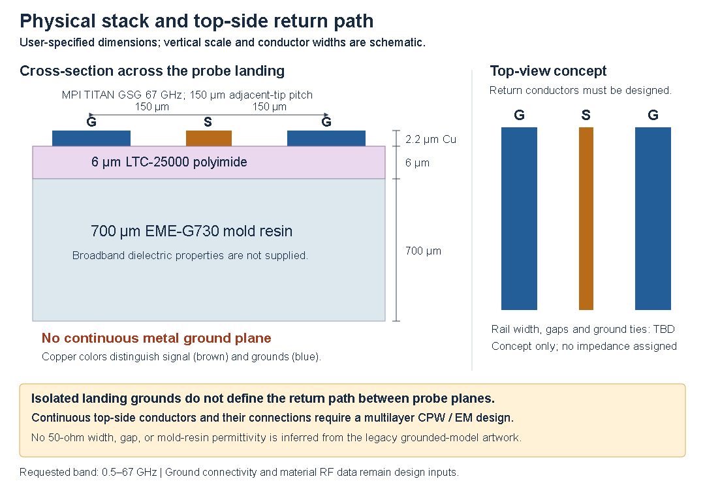

# RF Test Designer

BASIC programs for RF test-coupon planning, ring-resonator geometry, matrix operations, and long-integer arithmetic. The project contains the original **Hand BASIC** programs and **Commodore 64 BASIC V2** translations for the VICE emulator.

- [Read the preview report](reports/handbasic-ltc25000-eme-g730.pdf). It carries the equations, worked reference values and expected test data for each coupon, plus a section on the GDSII cells.
- [Browse the preview files](handbasic-previews). Download or clone the project and open `handbasic-previews/index.html` for the gallery.
- [Hand BASIC instructions](HAND_BASIC_README.txt).
- [C64 / VICE instructions](C64/README.txt).
- [GDSII unit-cell generators](gds/README.txt): one cbmbasic script per RF structure, each with a ground plane.
- [RF_Test_Structures report](reports/RF_Test_Structures-ltc25000-eme-g730.pdf): an earlier hand-edited draft, kept as supplied.

## Current physical stack

| Item | Configuration |
| --- | --- |
| Frequency range | 500 MHz to 67 GHz |
| Top copper | 2.2 µm |
| Insulation | 6 µm cured FUJIFILM LTC-25000 polyimide |
| Substrate | 700 µm EME-G730 mold resin |
| Ground configuration | Top-side GSG grounds only; **no continuous ground plane** (the GDSII cells below add a plane under the polyimide) |
| Probes | MPI TITAN, rated to 67 GHz, 150 µm adjacent-tip pitch |



**The existing electrical models do not predict this physical stack.** Their feed/line equations assume homogeneous microstrip or grounded coplanar waveguide. Leakage and via matching use additional idealized plate and closed-return models. Connected top-ground geometry and an ungrounded multilayer CPW model are needed before assigning fabrication dimensions, impedance, attenuation, crosstalk, or resonances to the supplied stack.

The preview atlas labels native numerical values and archived response curves as **hypothetical reference calculations**. Constant relative permittivity `er=3.3` and loss tangent `0.01` are illustrative reference assumptions, not verified broadband LTC-25000 properties. No EME-G730 dielectric constant or loss tangent has been assigned. See the report for material-source limits and the changes needed in each RF program.

## Programs

The root folder contains ten Hand BASIC programs. Their C64 counterparts are in `C64/`.

| Hand BASIC source | Purpose | External RF ports |
| --- | --- | --- |
| [rdlloss.bas](rdlloss.bas) | Differential conductor/dielectric-loss coupons | West / east |
| [rdxtalk.bas](rdxtalk.bas) | Coupled-line near- and far-end crosstalk | Four cardinal sides |
| [rfleak.bas](rfleak.bas) | Broadside overlap leakage and via-fence planning | West / east |
| [stubtest.bas](stubtest.bas) | Three-port shunt stub; P3 at branch end | West / east / north |
| [trlset.bas](trlset.bas) | Multiline TRL lengths and phase coverage | West / east |
| [viamatch.bas](viamatch.bas) | Stud/via surrogate and input matching | West only; internal load |
| [zcoupon.bas](zcoupon.bas) | Impedance and conductor-width variation | West / east |
| [resonator2.bas](resonator2.bas) | Circular/cosine-lobed ring geometry and GSG launch | West / east |
| [MATMUL.BAS](MATMUL.BAS) | Matrix library with 25 menu choices | Not applicable |
| [varprec.bas](varprec.bas) | Addition/multiplication of integers up to 88 digits | Not applicable |

[C64/RING67.TXT](C64/RING67.TXT) and [C64/RING67.PRG](C64/RING67.PRG) are a separate stock-C64 synthetic two-port ring-response demonstration. RING67 is not an additional Hand BASIC program or a solver for the physical stack above. Its fixed-decimal formatter has been corrected and checked in VICE.

## Probe arrangement

STUBTEST is a three-port exception to the usual west/east two-port coupons: P1 is west, P2 east and P3 north at the shunt-branch end. VIAMATCH has one west input and an internal load.

The revised Hand BASIC and C64 drawings connect ground rails along the signal paths, including bends, stub branches and the ring's outer return paths. RFLEAK now shows an upper-left L1 trace connected by a via to a lower-right L2 trace, with separate G-S-G vias returning to the east top-side pads. Its top view and signal side view show connectivity, not fabrication dimensions. The unchanged RFLEAK calculations describe isolated plates and **do not model this via-connected coupon**.

RDXTALK uses the following four-port mapping to avoid crossed signal routes:

| Port | Side | Role |
| --- | --- | --- |
| P1 | West | Aggressor near end / input |
| P2 | North | Aggressor far end / through |
| P3 | South | Victim near end |
| P4 | East | Victim far end |

With P1 driven, `S21` is aggressor through, `S31` is near-end crosstalk, and `S41` is far-end crosstalk. North/south GSG triplets rotate 90 degrees. The adjustable 1,000 µm adjacent landing-centre rule does not certify clearance of the actual probe bodies, mounts, or overtravel. RDXTALK needs four calibrated port planes; the existing TRLSET generator is two-port.

## GDSII unit cells

The [`gds`](gds) folder has eight CBM BASIC V2 scripts, one per RF structure, that write binary GDSII unit cells with a continuous ground plane (layer 1) directly under the 6 µm polyimide. That is the condition the reference models assume, so the report's numbers and expected data apply to these cells. Generated `.GDS` files, SVG/PNG previews and a verifier are included.

```powershell
powershell -File gds/run_gds.ps1      # regenerate all cells and verify them
node gds/verify_gds.mjs gds/ZCOUPON.GDS
```

The scripts need an SDL build of cbmbasic (they call `SYSTEM`) plus `certutil` or `xxd`. See [gds/README.txt](gds/README.txt) for the layer map and options. RFLEAK is drawn as a via-connected layer transition; the isolated-plate leakage model is not drawn.

## Run in Hand BASIC

1. Use `NEW` before importing the desired root-folder `.bas` listing.
2. Load/import through the app's normal file workflow, then enter `RUN`.
3. Use the program's example/custom menus and touch or keyboard controls.

These sources use native Hand BASIC graphics commands. They are not stock C64 listings. The atlas does not change the original BASIC defaults or implement the required ungrounded multilayer CPW model.

## Run in VICE

Autostart an individual `C64/*.prg` through VICE's file menu, then enter `RUN` if needed. Alternatively, attach [C64/RFTEST.d64](C64/RFTEST.d64) to drive 8 and enter:

```basic
LOAD"$",8
LIST
LOAD"RDXTALK",8
RUN
```

Choose a program name from the directory listing. `RFTEST.d64` contains the ten translated `.bas` programs; the separate `RING67.PRG` is loaded directly. The eight original RF translations use multicolor bitmap diagrams and standard text output. RING67 has its own bitmap plot display.

To rebuild the ten translated PRG files and disk image, supply the folder containing VICE's `petcat.exe` and `c1541.exe`:

```powershell
powershell -File C64/build.ps1 -ViceDirectory "C:\path\to\VICE"
```

This disk build does not regenerate the separate RING67 program. Further details are in [C64/README.txt](C64/README.txt) and [C64/RING67_README.txt](C64/RING67_README.txt).

## Preview atlas and PDF report

The delivery includes 14 RF drawing views, two utility text previews, a physical-stack concept figure, and seven archived reference-response plots. SVG files provide editable vector artwork; PNG files provide viewing images.

- RF artwork executes the native source drawing statements with a limited host interpreter.
- Utility previews extract the initial literal source text.
- The mobile Hand BASIC app is not executed by these generators.
- Source artwork is schematic and is not a scaled fabrication mask.
- Ring previews explicitly flag both the absent backplane and the copper-thickness input limit: at 6 µm insulation, the existing interactive guard permits 0.6 µm copper, below the requested 2.2 µm.

The [parameter profile](handbasic-preview-profile.json) records user inputs, illustrative assumptions, and model applicability. Manifests record source/profile hashes and calculation entry points. Text hashes normalize line endings to LF so provenance remains consistent across operating systems.

The report is compiled with **pdfLaTeX**. Rebuild from the project folder with Node.js, ImageMagick, and `pdflatex` on `PATH`:

```powershell
powershell -File reports/build.ps1
```

This regenerates the previews and reference data, checks source/profile consistency, builds the gallery, and runs pdfLaTeX twice. The editable report source is [reports/handbasic-ltc25000-eme-g730.tex](reports/handbasic-ltc25000-eme-g730.tex). Final report figures are retained in `reports/assets/`; intermediate files go to the ignored `tmp/` folder.

To compile using existing matching previews:

```powershell
powershell -File reports/build.ps1 -SkipPreviews
```

Individual generators:

```powershell
node preview_handbasic_rf.mjs
node preview_handbasic_ring.mjs
node preview_handbasic_utilities.mjs
node analyze_handbasic_rf.mjs
```

The compatibility command `node preview_handbasic_cardinal.mjs` now invokes the complete RF artwork generator.

## Verification

The report build includes 70 numerical cross-checks between the independent reference calculations and source-driven routines. The PDF was rendered and visually checked across all 18 pages. All gallery asset links were checked. These checks establish reproducibility and presentation; they do not validate the actual stack's RF performance or mobile-app behavior.

Existing checks can be repeated separately:

```powershell
node verify_handbasic_cardinal.mjs
node C64/verify_artifacts.mjs
node C64/verify_ring67.mjs "C:\path\to\VICE"
```

See [HAND_BASIC_VALIDATION.txt](HAND_BASIC_VALIDATION.txt), [C64/VALIDATION.txt](C64/VALIDATION.txt), and [C64/ring67-validation.txt](C64/ring67-validation.txt) for the checks and their limits.

## License

See [LICENSE](LICENSE) for the GNU General Public License, version 3.
